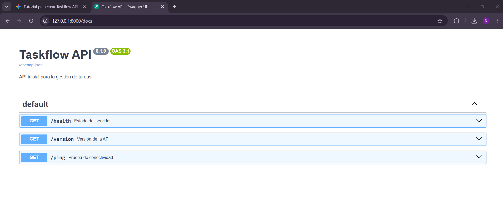
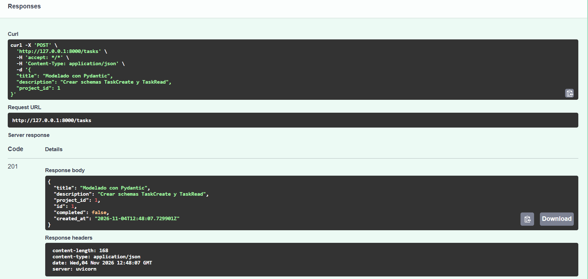
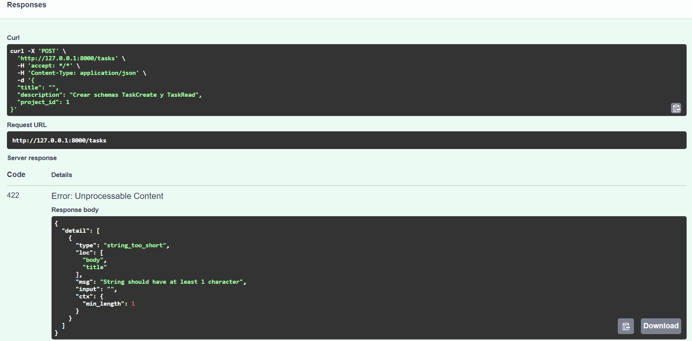

# Entregable Práctica 1.1

**Repositorio Git:** https://github.com/Comans28/taskflow-api.git

## Captura de /docs

---

## Práctica 1.2 — Modelado con Pydantic

### Concepto de Schema (Contrato de API) vs Modelo de Base de Datos (Persistencia)
* **Schema (Pydantic - Contrato de API):** Define la estructura, tipos de datos y reglas de validación que la API acepta en las peticiones de entrada (`TaskCreate`, `ProjectCreate`) y devuelve en las respuestas de salida (`TaskRead`, `ProjectRead`). Actúa como el contrato público de comunicación en formato JSON entre el cliente y el servidor.
* **Modelo de Base de Datos (ORM - Persistencia):** Representa las tablas físicas y relaciones dentro del motor de base de datos. Separar los schemas de los modelos de persistencia permite validar datos antes de tocar la base de datos y ocultar campos internos o sensibles sin acoplar la API al esquema de tablas.

### Pruebas de validación en Swagger (`POST /tasks`)

1. **Caso válido (`201 Created`):** Envío de un objeto `TaskCreate` cumpliendo las restricciones de `Field`, devolviendo el objeto `TaskRead` simulado.

2. **Caso inválido (`422 Unprocessable Content`):** Envío de `"title": ""` incumpliendo la restricción `Field(min_length=1, max_length=100)`.
