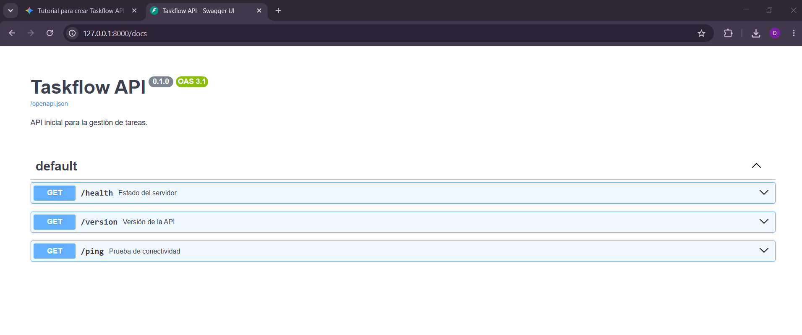
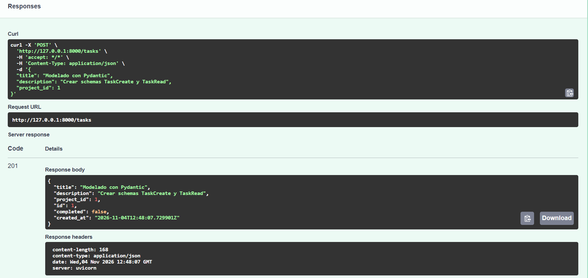
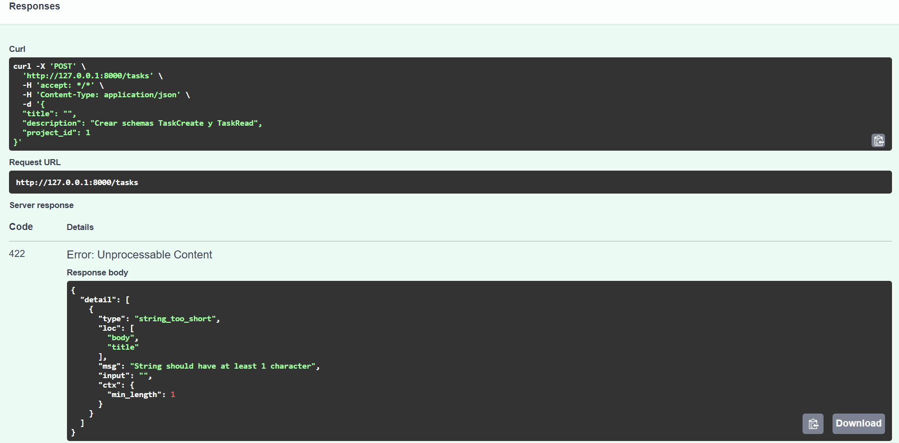
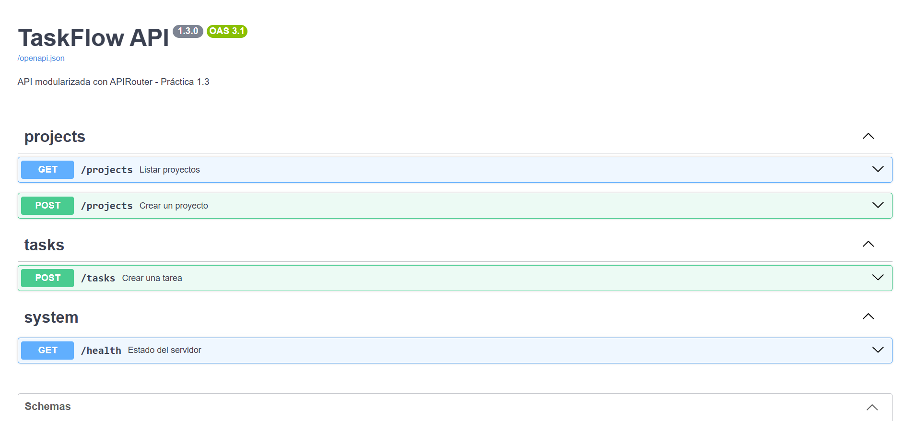
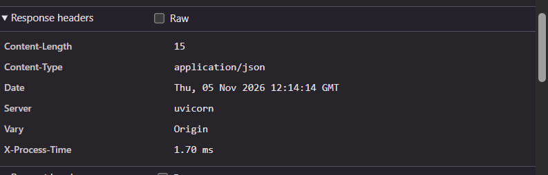
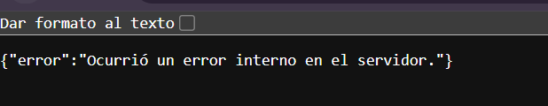

# Entregable Práctica 1.1

**Repositorio Git:** https://github.com/Comans28/taskflow-api.git

## Captura de /docs

---

## Práctica 1.2 — Modelado con Pydantic

### Concepto de Schema (Contrato de API) vs Modelo de Base de Datos (Persistencia)
* **Schema (Pydantic - Contrato de API):** Define la estructura, tipos de datos y reglas de validación que la API acepta en las peticiones de entrada (`TaskCreate`, `ProjectCreate`) y devuelve en las respuestas de salida (`TaskRead`, `ProjectRead`). Actúa como el contrato público de comunicación en formato JSON entre el cliente y el servidor.
* **Modelo de Base de Datos (ORM - Persistencia):** Representa las tablas físicas y relaciones dentro del motor de base de datos. Separar los schemas de los modelos de persistencia permite validar datos antes de tocar la base de datos y ocultar campos internos o sensibles sin acoplar la API al esquema de tablas.

### Pruebas de validación en Swagger (`POST /tasks`)

1. **Caso válido (`201 Created`):** Envío de un objeto `TaskCreate` cumpliendo las restricciones de `Field`, devolviendo el objeto `TaskRead` simulado.

2. **Caso inválido (`422 Unprocessable Content`):** Envío de `"title": ""` incumpliendo la restricción `Field(min_length=1, max_length=100)`.

---

## Práctica 1.3 — Organización con APIRouter

### Modularización y Separación de Responsabilidades
* **Uso de APIRouter:** Se han separado las rutas por recurso creando los routers independientes `app/routers/projects.py` y `app/routers/tasks.py`, aplicando prefijos coherentes (`/projects`, `/tasks`) y etiquetas (`tags`).
* **Separación en `main.py`:** El archivo principal `main.py` se ha mantenido limpio de lógica de negocio, limitándose a instanciar la aplicación FastAPI y a registrar los routers mediante `app.include_router(...)`[cite: 10].

### Documentación en Swagger
Vista de la API con los endpoints organizados y agrupados por recursos:

---

## Práctica 1.4 — Middleware y Manejo de Excepciones

### Comportamiento Transversal y Seguridad
* **CORS Middleware:** Configurado mediante `CORSMiddleware` para permitir peticiones desde el origen del frontend (`http://localhost:5173`), habilitando los métodos y cabeceras necesarios para la integración cliente-servidor.
* **Middleware Personalizado (`X-Process-Time`):** Intercepta de forma transversal las peticiones HTTP para calcular el tiempo de procesamiento y añade la cabecera `X-Process-Time` con la duración en milisegundos en cada respuesta.
* **Manejador Global de Excepciones:** Captura cualquier excepción no controlada (`Exception`) a nivel global, evitando la exposición del *stacktrace* interno del servidor y devolviendo una respuesta segura con código `500 Internal Server Error` y un formato JSON estandarizado[cite: 16].

### Pruebas y Capturas

1. **Cabecera `X-Process-Time` (Inspección en DevTools / Red):**
   *(Asegúrate de guardar tu captura de la cabecera con este nombre o el que prefieras en la raíz del proyecto)*
   

2. **Manejo Global de Excepciones (`/error-test` - Código 500):**
   
  
